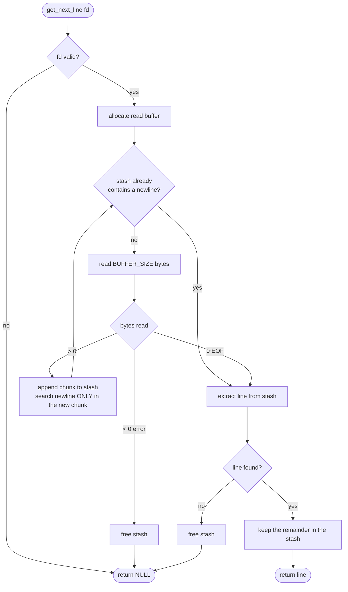

*This project has been created as part of the 42 curriculum by fercarva.*

<div align="center">

# 📖 get_next_line

**Reading a line from a file descriptor, one call at a time.**


[Description](#-description) •
[Instructions](#-instructions) •
[Algorithm](#-algorithm) •
[Project structure](#-project-structure) •
[Testing](#-testing) •
[Resources](#-resources)

</div>

---

## 📌 Description

`get_next_line()` returns **one line per call** from a file descriptor. Calling it repeatedly in a loop reads the whole file, one line at a time, until there is nothing left to read.

```c
char *get_next_line(int fd);
```

| Situation | Return value |
|---|---|
| A line was read | The line, **including** the terminating `\n` |
| Last line of a file that does not end with `\n` | The line **without** `\n` |
| End of file reached, or a read error occurred | `NULL` |

The project is also an introduction to **static variables**: the function must remember what it has already read between two calls, without using any global variable.

### What it handles

- Regular files **and** standard input (`fd = 0`), pipes and any other readable file descriptor
- Any `BUFFER_SIZE`, from `1` to `10000000` and beyond
- Very long lines (several megabytes) in linear time
- Empty files, files with only `\n`, files without a trailing `\n`
- Invalid file descriptors (`fd < 0`, closed fd) and `read()` errors, without crashing or leaking
- **Bonus:** several file descriptors at the same time, using **one** static variable

> ⚠️ Reading a binary file or reading a file modified between calls is undefined behavior, as stated in the subject.

---

## 🛠 Instructions

### Requirements

- A C compiler (`cc`)
- Only `read`, `malloc` and `free` are used. `libft` and `lseek` are **not** used, and there are no global variables.

### Compilation

The buffer size is chosen at compile time with `-D BUFFER_SIZE=n`. If the flag is omitted, a default value defined in the header is used (`10`), so the project compiles both **with** and **without** it.

**Mandatory part**

```bash
cc -Wall -Wextra -Werror -D BUFFER_SIZE=42 get_next_line.c get_next_line_utils.c <your_main>.c
```

**Bonus part**

```bash
cc -Wall -Wextra -Werror -D BUFFER_SIZE=42 get_next_line_bonus.c get_next_line_utils_bonus.c <your_main>.c
```

> This repository contains **no `main`**: only the function, its helpers, the headers and the Makefile. You provide your own `main` to use it (see [Testing](#-testing)).

### Using it in your code

```c
#include "get_next_line.h"   // or "get_next_line_bonus.h"

char *line;

while ((line = get_next_line(fd)) != NULL)
{
	/* ... use line ... */
	free(line);              // the caller owns the returned string
}
```

<details>
<summary><b>🔧 Makefile rules</b></summary>

<br>

| Rule | What it does |
|---|---|
| `make` / `make all` | Builds the mandatory part |
| `make bonus` | Builds the bonus part (multi-fd) |
| `make clean` | Removes object files |
| `make fclean` | Removes object files and the output |
| `make re` | Rebuilds everything from scratch |

The Makefile compiles with `cc -Wall -Wextra -Werror` and does not relink unnecessarily.

</details>

---

## 🧠 Algorithm

### The idea in one picture



### Step by step

1. **Static stash.** A `static` pointer keeps the text that was read from the file but not yet returned (the *remainder*). It survives between calls, which is what makes "one line per call" possible. In the bonus it is `static char *stash[1024]`, one slot per file descriptor, still **a single static variable**.
2. **Read only as much as needed.** `read()` is called in chunks of `BUFFER_SIZE` **until the stash contains a `\n` or the end of file is reached**. The whole file is never loaded at once.
3. **Extract the line.** Everything up to and including the first `\n` is copied into a new string that is returned to the caller.
4. **Keep the remainder.** What comes after the `\n` becomes the new stash. If nothing remains, the stash is freed and set to `NULL`.

### Why this algorithm?

A naive implementation joins the stash and the new chunk with a `strjoin` on every `read()` and searches for `\n` from the start of the stash each time. That works, but it is **quadratic**: with a small `BUFFER_SIZE` and a huge line, the stash is copied and scanned again and again.

| Approach | Cost for a line of `n` bytes | Verdict |
|---|---|---|
| `strjoin` + `strchr` on the whole stash at every read | `O(n² / BUFFER_SIZE)` | Simple, but too slow on giant lines |
| **Growable stash (capacity doubles) + search only the new chunk** | **`O(n)` amortized** | ✅ Chosen |
| Linked list of chunks | `O(n)` | Fast, but needs a more complex structure and an extra pass to build the line |

In local benchmarks with `BUFFER_SIZE=10`, a single 1 MB line took **more than 60 seconds** with the naive approach (and made the strict test of [francinette](https://github.com/xicodomingues/francinette) time out). With the growable stash, a **5 MB line takes about 0.1 seconds**.

**How the growth works** (`ft_grow` + `ft_append`):

- The stash has a length (`len`) and a capacity (`cap`), kept as local variables during the read loop.
- When a new chunk does not fit, the capacity becomes **twice the required size** and the content is copied once.
- Because capacity doubles, each byte is copied only a constant number of times on average. That is what makes the append **amortized `O(1)` per byte**.
- The newline search starts at the beginning of the **newly appended chunk**, so no byte is scanned twice.

### Memory management

- The read buffer is allocated at the start of each call and freed before returning.
- On `read()` errors or allocation failures, the stash of that file descriptor is freed and reset to `NULL`.
- At end of file, the stash is freed automatically when no remainder is left.
- The returned line belongs to the caller, who must `free` it.

### Complexity

| | |
|---|---|
| **Time** | `O(n)` for a line of `n` bytes (amortized) |
| **Extra space** | `O(n)` for the stash, up to `2n` right after a growth, plus `BUFFER_SIZE + 1` for the buffer |

---

## 🗂 Project structure

```
.
├── get_next_line.c            # get_next_line + main helpers
├── get_next_line_utils.c      # string and memory helpers
├── get_next_line.h            # prototypes, BUFFER_SIZE, SEPARATOR
├── get_next_line_bonus.c      # multi-fd version
├── get_next_line_utils_bonus.c
├── get_next_line_bonus.h
├── Makefile
└── README.md
```

<details>
<summary><b>📚 Function reference</b></summary>

<br>

**`get_next_line.c`**

| Function | Role |
|---|---|
| `get_next_line(int fd)` | Entry point. Validates the fd, allocates the buffer, orchestrates the steps |
| `ft_read_stash(stash, buffer, fd)` | Reads chunks and appends them to the stash until a newline or EOF |
| `ft_extract_line(stash)` | Builds the line to return (up to and including `\n`) |
| `ft_update_stash(stash)` | Builds the remainder that stays for the next call |
| `get_line_final(stash)` *(bonus)* | Extracts the line and updates the slot of the current fd |

**`get_next_line_utils.c`**

| Function | Role |
|---|---|
| `ft_strlen(s)` | Length of a string (`NULL`-safe) |
| `ft_strchr(s, c)` | First occurrence of `c` in `s`, or `NULL` |
| `ft_grow(stash, len, cap, need)` | Makes sure the stash has room for `need` bytes, doubling its capacity when it does not |
| `ft_append(stash, buffer, len, cap)` | Appends a chunk to the stash and keeps it null-terminated |

</details>

<details>
<summary><b>⭐ Bonus: multiple file descriptors</b></summary>

<br>

The bonus keeps **one stash per file descriptor** in a single static array:

```c
static char *stash[1024];
```

- Reading fd 3, then 4, then 5, then 3 again returns each file's next line without mixing states.
- Only **one** static variable is used, as required.
- File descriptors outside `0 … 1023` return `NULL`.

</details>

---

## 🧪 Testing

There is no `main` in this repository, so create one **outside** the submitted files. A minimal example:

<details>
<summary><b>▶ Minimal test program</b></summary>

<br>

```c
#include "get_next_line.h"
#include <stdio.h>
#include <fcntl.h>

int	main(void)
{
	int		fd;
	char	*line;

	fd = open("test.txt", O_RDONLY);
	if (fd < 0)
		return (perror("open"), 1);
	while ((line = get_next_line(fd)) != NULL)
	{
		printf("%s", line);
		free(line);
	}
	close(fd);
	return (0);
}
```

```bash
printf 'line 1\nline 2\nlast line without newline' > test.txt
cc -g -Wall -Wextra -Werror -D BUFFER_SIZE=3 get_next_line.c get_next_line_utils.c main.c
./a.out
```

To read from standard input instead, use `fd = 0;` and finish with `Ctrl+D`.

</details>

### What to test

| Case | Why it matters |
|---|---|
| `BUFFER_SIZE` = `1`, `10`, `9999`, `10000000` | The function must not depend on the buffer size |
| Empty file / only `\n` / several consecutive `\n` | Edge cases of line splitting |
| File without a trailing `\n` | The last line must be returned without `\n` |
| Very long line (millions of characters) | Checks linear-time behavior |
| `fd = -1`, closed fd | Must return `NULL`, never crash |
| Standard input and pipes | A fd is not always a regular file |
| Bonus: alternate between 3+ fds | States must not mix |
| Memory | Run with `valgrind --leak-check=full` or `-fsanitize=address` |

Automated testers used: [francinette](https://github.com/xicodomingues/francinette) (`francinette --strict`) and `norminette`.

---

## 📎 Resources

### References

- `man 2 read`, `man 3 malloc`, `man 3 free`
- [Static storage duration (cppreference)](https://en.cppreference.com/w/c/language/storage_duration)
- [Dynamic array and amortized growth (Wikipedia)](https://en.wikipedia.org/wiki/Dynamic_array)
- [francinette, a 42 project tester](https://github.com/xicodomingues/francinette)
- The 42 Norm and the `get_next_line` subject

### 🤖 How AI was used

AI was used as a study and support tool. It helped me understand how
static variables and `read()` work, break the problem into smaller steps, and
review my code (Norm, edge cases, memory). It also helped me find the cause of a
performance issue with very long lines and draft this README.
The code was written, tested and is understood by me.
The final code was reviewed, tested and is understood by the author.

---

<div align="center">

*Made at 42 Porto by fercarva*

</div>
